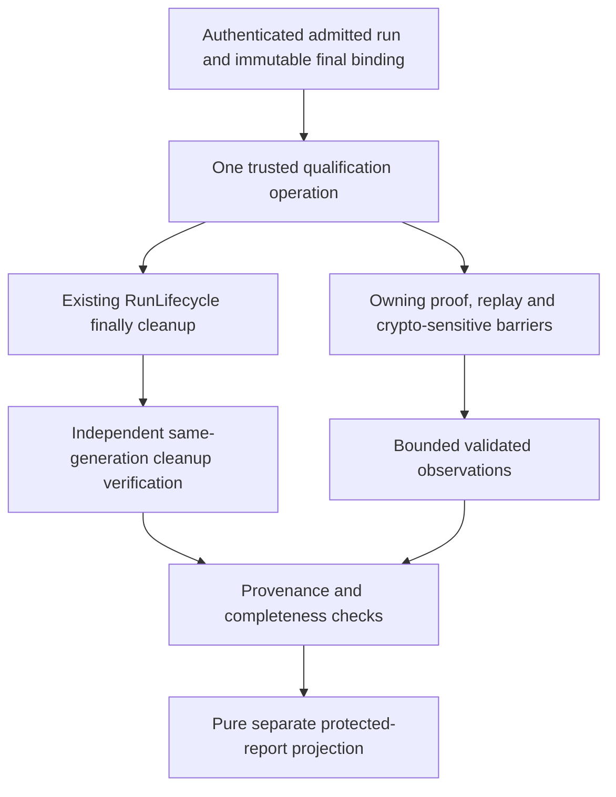

# T012T qualification and protected-report source plan

Status: draft
Kind: implementation-plan
Scope: accepted preparation and private39 source decision; isolated realization candidate under validation
Factory decision: opensoft/openXfactory openspec/changes/add-protected-runtime-report
Sole executable list: tasks.md, proposed T012T01-T012T06

Current commission/status: [accepted-budget source realization](hosting-evidence-budget-realization.md). The earlier [partial blocker](hosting-evidence-implementation.md) remains historical.
Historical preparation text below records its earlier source checkpoint; it is not a claim of current implementation permission or completion.

## Accepted baseline and authority

Brett source-ratified #75 at `dbe855cf3a41475426cd1329ca46d7b95dee2905`.
It landed normally as `d832709a1119c17014287cd15ff8661bfd758cc4`; actual tree
`2e058d12f1f32c2795629ea21e305cc1f6131dfe` equals the clean integration of that
head and prior main `fce58c192e93be9678cfd94fee81f9dacd41e5aa`. The inherited
P1 OpenSpec consumer fixes do not change lifecycle runtime or feature017 content.
[Post-merge CI](https://github.com/opensoft/openXwallet/actions/runs/43887121548)
passed 2,322 full tests plus nine subtests with three shallow-history skips,
and all 2,017 mandatory native cases with zero skips. H05=29/H11=119.

The current instruction commissions T012T preparation only. New factory profile
acceptance and explicit isolated implementation remain prerequisites. T012U-V,
T001/T013-T015, setup, protected dispatch, live reporting and consumer/human/domain
acceptance remain separate. Feedback stays deferred; blocked writes are not replayed.

## Technical context and source audit

Retain Python 3.12, the existing hash-locked dependency closure, pinned owning
wallet code, existing runtime-v1/static-v2 inputs and seven service/eight source
roles. Add no SDK, plugin loading, environment activation switch or worker input.
No source/runtime/workflow/dependency/pin change is made by this plan.

| Existing source | Current behavior | T012T handoff |
| --- | --- | --- |
| `scripts/workload_factory_binding_runtime/evidence.py` | Source/fixture-only closed v1 report; no protected scope or authenticated observation inference | Keep compatible; new report belongs in a separate internal module |
| `scripts/prepare-protected-runtime.py` and `workflow.operational_bindings()` | Default refuses before outputs/OIDC; qualify/cleanup are unimplemented | Later explicit trusted integration only; operational default continues to refuse |
| `runtime.RuntimeBinding.sign` | Per-use current admission, owning proof path and lifecycle checkpoint | Invoke the actual bound path; do not substitute a pass boolean |
| `lifecycle.RunLifecycle.run` | One-use operation, failure/cancel preservation, independent cleanup verification | Wrap one qualification operation and consume its existing cleanup result |
| `hosted.lifecycle` / `lifecycle_service` | Durable exact-generation stage/final ownership and independent audit | Reuse; report generation cannot repeat mutation or repair state |
| `tests/runtime_binding/matrix_contract.py` | 2,017 native nodes; H10 budget anchors; no H12 report anchor | Preserve every baseline identity/fingerprint/anchor and measure additions after implementation |

See [interface design](contracts/hosting-evidence.md), [acceptance controls](hosting-evidence-acceptance.md)
and [consistency analysis](hosting-evidence-analysis.md).

## Constitution and ownership check

Use current repository AGENTS and the shared OpenSpec/Speckit protocol. There is
no repo-local `.specify/memory/constitution.md`; no new constitutional authority
is invented. The factory owns closed composition/report vocabulary; upstream
openWallet/openMFA retain neutral proof/registry/custody contracts. This adapter
owns only the future binding implementation and this one feature task list.
Every gate remains offline; source qualification is not operational acceptance.
Host-specific paths, raw secrets, mutable CI expectations and duplicate task lists
are excluded. The factory packet is draft and supplies no implementation permission.

## Proposed source architecture

Trusted hosting supplies an admitted actual run, immutable finalized configuration,
existing RuntimeBinding/RunLifecycle and authenticated current observation ports.
No request body, Python identity string or report payload establishes those facts.
The protected report is a factual projection, never a proof or approval token.

### 1. Trusted qualification construction

Proposed new internal `hosted/qualification.py` composes existing capabilities;
it adds no runtime service role or connector discovery. Fixed case validators
consume authenticated phase facts from admission, finalization, enrollment/issuance,
source/protection, guest/kernel and lifecycle. Callbacks cannot supply uncorroborated
pass flags. Bind every observation to the actual case, first run/attempt, accepted
sources, finalized config/policy/composition and exact worker generation.

H01-H09 observations come from those actual phase decisions, not rerunning pytest.
Execute H10 through the existing owning-wallet path. Preserve one proof's bounded
scope; verify exact replay refusal and valid-signed audience-only/environment-only
negative controls. Preselected negative controls require their own allowed case
capability; do not add arbitrary signing or expose custody material to make them
possible. A worker denial needs an available authorized positive and a disposable
excess-permission counterfactual. Missing live capabilities remain unperformed.

### 2. Operation, cancellation and cleanup

Use one `RunLifecycle.run(operation)` call. Do not catch an operation failure and
return a success result. Preserve BaseException cancellation after its cleanup path.
Capture bounded case facts locally, then consume `cleanup_verification` from the
same immutable RunPlan and audit identity. Report assembly must not call finalize,
retry a lost mutation or allocate a new launch/generation.

A future explicit CLI qualify route may delegate only through trusted hosting
bindings and the already admitted context. Cleanup-phase source integration reads
or reconciles the same registered reference and independent audit; it does not
resubmit a consumed unknown action. The existing independent scheduler remains
responsible after runner death. Missing generation/ack/init/journal/audit or lost
control-host capability stays owned/unverified; never infer absence from an outage.

Keep ordinary protection3/total13, protected-staging total26/private16,
finalization six observations/protection18/total28/private12, and existing
per-reader/non-GitHub bounds. Each phase retains its original Decision and earliest
expiry. Cleanup retains its registered cleanup_until and timeout. The journal's
2,048-event cap, closing-clock reservation and exhaustion refusal remain intact.
If a required positive cannot fit, stop for separate factory review; no budget reset.

### 3. Separate pure report projection

Proposed `hosted/evidence.py` implements only the reviewed factory profile.
The factory candidate `opensoft/openXfactory`,
`openspec/changes/add-protected-runtime-report/design.md`, owns the proposed exact
fields/case vocabulary. It is not an accepted main specification.
Keep existing `evidence.py` scopes/case vocabulary/outputs compatible.

Require independently authenticated operational provenance before new-profile
emission. Even a complete real local fixture run remains source/fixture evidence;
a caller-selected live label does not upgrade it. Pure encoder golden vectors are
test artifacts, not protected outputs, artifacts for upload or T014 receipts.
Source/fixture records cannot be relabeled into the new profile.

Return bounded canonical bytes to trusted hosting only. Add no uploader, filesystem
sink, artifact path, bearer token or operational retention selection here. Missing
facts produce honest incomplete/refused reporting, never placeholders. A fresh
independent cleanup result must bind the same actual scope/plan/generation/attempt.
The report records historical facts and cannot reactivate a configuration or renew
an operation. Human approval, domain effect and consumer lock remain false.

H12 privacy observation covers the redacted pre-report projection and independent
privacy controls. It cannot hash the final report containing its own result digest.
Any final content hash is external and is not authenticated provenance by itself.

## Source validation and qualification handoff

After later implementation, exercise [acceptance controls](hosting-evidence-acceptance.md)
with real local TLS/process/custody and the pinned owning verifier. Each meaningful
negative has a valid positive and one isolated mutation. Preserve old tests rather
than mirroring implementation. Keep default CLI refusal before outputs/OIDC.

Measure new module node IDs/digests and substantive H10/H12 anchors only after
actual collection; preserve all 2,017 current required nodes. No new count is guessed
by this plan or regenerated during CI. Use the established pin/syntax/plain/strict,
full, pinned OpenSpec and mandatory isolated conformance gates when source is
commissioned. Audit exact-generation fixture teardown before removing task roots.
T012U broader H01-H12/operator runbook and T012V final source handoff are not completed
by this bounded T012T plan.

Preparation now runs document/link/scope checks and default pinned OpenSpec strict
validation only. Runtime tests are not rerun for these document-only artifacts;
post-merge source CI above establishes the inherited implementation baseline.

## Remaining owner gates

The paired draft requires factory report-profile and adapter-plan source acceptance
before implementation. T013 must select actual authenticated qualifier/negative-case
capabilities, source/custody/issuance/retention and independent cleanup/watchdog facts
and grant bounded operational authority. T014 must independently observe live P01
and deployed G02/G03/L01; T015 must separately accept delivery. A machine report
cannot finish codeXfactory 058 T002 or its human/domain gates by itself.

## Preparation publication handoff

Local preparation branches contain the factory proposal and this adapter plan.
They are not new published PRs and have no fresh candidate hosted-CI/review claim.
Factory ledger provenance must be generated after a real moving factory PR number
exists, as recorded in hosting-evidence-analysis.md. No placeholder is committed
as provenance. Publish/review the paired preparation candidates when separately
requested, then present exact heads for owner profile acceptance; do not run apply
or treat planning artifacts as implementation permission.
