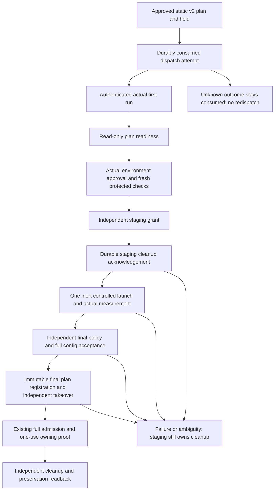

# Proposed hosting and finalization model

Status: draft
Kind: design
Ownership: internal factory composition; no neutral schema/API change

## Entities and authority

| Entity | Committed/observed binding | State and refusal |
| --- | --- | --- |
| StaticPlanV2 | Exact configuration/policy/measurement/derivation/staging templates, host selection digest and source-hold ref | Draft until actual source/plan approval; all static bytes immutable; exactly four late config paths absent |
| HostingSelection | Accepted target/source/image/guest/issuer/service/state/scheduler/evidence and privilege policy refs | Operator-owned; actual current readback required; labels or copied candidate data do not authenticate |
| PlanAdmission | Principal/purpose/phase, plan/case/source/actual first run, current hold/protection and existing environment | Read-only bounded readiness; no full config/grant/proof-ready output or worker start |
| StageLaunchGrant | Independent issuer, plan/case/run/source/host/template/nonreusable launch ref/window/action | Separate narrow current authority after actual environment approval; no signing right |
| StagingLease | Same scope plus durable acknowledged ownership, external janitor/scheduler and expiry | Registered before effects; consumed/indeterminate on ambiguity; cleanup never depends on a final config existing |
| LaunchGeneration | Authenticated host resource/incarnation/boot, manager unit/invocation and actual PID/start, immutable artifacts/config projection | Fixed generation, not worker-selected; mismatches refuse; no replacement under consumed scope |
| FinalizationBinding | Exact plan, run/host/generation, derived composition/policy/full config and independent accepting authority | Recompute canonical bytes; no launcher-digest self-approval; one final binding or indeterminate refusal |
| FinalRunPlan | Existing full-config-bound scope/lease, linked stage/generation, independent takeover acknowledgement | New immutable record; no destructive promotion or implicit deadline extension |
| Enrollment/IssuedCapability | Actual provider/guest nonce/source/key/role, issuer/key version, effective permission/expiry/revocation | Private capability path; worker never receives it; uncertainty prevents qualified cleanup |
| HoldObservation | Actual accountable coordination scope/source/window and supporting provider facts | Current and revocable; no atomic provider pin or hostile-admin guarantee |
| CleanupObservation | Separate authenticated actual generation/absence/revocation and retained/shared preservation | Exact target, case/run and scope; writer success/finally alone is insufficient |
| ProtectedReportV1 (proposed) | Independently qualified live source/provider/guest/issuer/case/run/results/cleanup with closed safe projection | Separate version/profile; old source/fixture report stays unchanged; no human/domain authority |

## Exact derivation boundary

The plan contains every static full runtime field except:

- launch.run_id and launch.run_attempt: independently corroborated GitHub first run.
- composition_digest: existing measured artifacts plus actual launch projection/generation.
- authority.policy_digest: canonical accepted policy template with that measured composition.

All service/state/lifecycle/policy/grant handles remain preallocated static values.
A handle may identify a future record but cannot confer its authority before actual
issuance/binding. No broad object omission or arbitrary host-generated field is allowed.
Policy static claims remain the existing set; measurement projection intentionally
excludes self-referential hashes. Compute actual run/projection -> measured composition
-> complete policy bytes/digest -> complete runtime config bytes/digest. Final authority
compares full derived bytes to the plan, then issues the bound current operation/state/
custody/lifecycle scope; it does not merely countersign a supplied hash.

## State transitions

All transitions require independently authenticated current source/authority and the
earliest scope deadline. Preflight has no effectful worker transition. Read-only
staging status polling is bounded to six decisions/60 seconds and cannot resend a
mutation, renew a grant or extend a lease. Expired readiness is reacquired only under
still-current independent case authority; it is never extended by copying a record.

A crash before final takeover leaves staging cleanup live. After independent takeover,
final cleanup owns the identical generation; stage tombstones and consumed dispatch
state remain. A changed generation, missing store or unsupported recovery refuses.
No state transition creates/reset replay storage or converts a synthetic observation
into provider proof. Infrastructure retirement has a separate ownership/conditional
semantics model and cannot be inferred from process/file/credential cleanup.

## Failure domains and evidence limits

Worker, gate and orchestration-runner death are covered by the separate control-host
janitor. Total control-host loss requires the independently selected external watchdog;
without it, cleanup/automatic expiry acceptance remains incomplete. Actual OS/issuer/
provider state must corroborate the declared topology. Trusted host-root, platform
administrators and measurement/issuer code remain in the TCB.

Staging/finalization records are not public neutral possession receipts. Protected
reporting requires separately accepted source and later real qualification. Raw token,
key, provider response, factor/browser state and exception payload are excluded from
all committed/redacted evidence. Consumer/human/domain acceptance remains separate.
