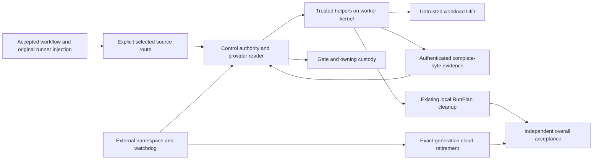

## Current qualified main and P06 preparation - 2026-11-22 America/La_Paz

Brett source-ratified #101 at `dc9ec9eb5e81` and #102 at `26e6a1efe739`.
The latter landed normally, without an approval override, as
`4ca798601566091564a5696fdd89559f8d207885`; its tree exactly matches the
ratified candidate. [Fresh main CI](https://github.com/opensoft/openXwallet/actions/runs/45055670097)
passes all five jobs, all 3,451 full parent tests plus 11 subtests and all
3,029 mandatory native cases, with zero failures, errors or skips.
All six unchanged Sonar conditions are evaluated and green: new coverage
87.4%, duplication 0.1%, reviewed hotspots 100%, and all three ratings at 1.
The original August 27 baseline is retained. Fresh GitHub main and the latest
Sonar main analysis agree on that merge in the [source qualification receipt](p3-parent-main-qualification.json).
This is an as-of source readback, not a permanent freshness or operational grant.
The two earlier #101 main timeouts remain diagnostic history.

Only [T013P06 preparation](p3-issuance-plan.md) is commissioned now.
Its existing implementation row stays unchecked; no P06 code or tests exist.
P07-P09, setup/dispatch, live issuer/provider appointments and human/consumer
acceptance remain separate. Feedback is deferred and blocked writes unreplayed.
Earlier dated status below is historical; feature017 operational tasks remain open.

## Historical #101 acceptance and initial P06 preparation - 2026-11-22 America/La_Paz

Brett ratified #101 at `dc9ec9eb5e81508ce99134b8c2c4a88c417aae88` for
source acceptance. Normal merge `841f1bd230ac4452d5663adc50569c072cd4d32f`
has the exact reviewed tree. Main CI attempt 1 timed out during native after the
full suite passed; attempt 2 also timed out at the same cap during native.
Both full suites passed, but neither native run completed and Sonar skipped.
Main qualification remains open; earlier PR/local qualification is distinct.

P06 preparation is authorized and captured in [the bounded subplan](p3-issuance-plan.md).
The existing T013P06 implementation row remains unchecked. No P06 code/tests,
setup/dispatch, P07-P09, live services or human/consumer acceptance are granted.
Feedback remains deferred and blocked writes unreplayed. Earlier dated status
below is historical; source acceptance does not supply operational authority.

# Implementation Plan: P3 Azure deployment composition

Historical bounded authority (2026-11-21 UTC): P01-P04 source is accepted and
Brett has commissioned isolated T013P05 implementation/testing. Its four
compatibility probes do not complete P05. The existing eligibility guard now
requires the proposed direct-v2 transaction amendment in factory #1359 with
adapter #100 to receive exact paired source acceptance before dependent code.
See [P05 work](p3-measurement-plan.md) and its [candidate transaction plan](p3-measurement-transaction-plan.md).
P06-P09 and all operational/human/consumer gates remain separate. Setup/dispatch
unauthorized; feedback deferred; blocked writes unreplayed.

## Historical source-acceptance and preparation checkpoints

The following checkpoints retain the authority available when recorded; the
current bounded commission above controls later isolated P05 work.

Current #99 source acceptance and P05 preparation: Brett ratified
9e46adca6ee3a4c4487fde93f6809b9f7c7a088c for source acceptance only. Normal merge
066cae664f4033ac3b5a508321e1a782b03cf4d4 preserves the ratified tree; independent
main CI and its actual unchanged Sonar/baseline gate pass. See feature017 evidence.md.
P01-P04 source is accepted. The next bounded subplan is p3-measurement-plan.md,
T013P05 preparation only. P05 implementation, P06-P09, T001/T013/T014/T015,
consumer058 T002, appointments and operational accepted_commit remain gated.
Setup/dispatch unauthorized; feedback deferred; blocked writes unreplayed.
Earlier dated checkpoints below retain their historical scope.

Current #98 source acceptance and P04 preparation (2026-11-20): Brett ratified
03d1ee71b53187b5b52233db02b7cca55281b3aa for source acceptance only. Normal merge
7f85c43c6a4eee311d7033e59df2d8bbd4b1ddf7 has the identical tree; independent main
CI and its actual unchanged Sonar/baseline gate pass. See feature017 evidence.md.
The next bounded subplan is p3-runner-transport-plan.md (T013P04 preparation only).
P01-P03 source is accepted; P04 code, P05-P09, T001/T013/T014/T015 and consumer058
T002 remain gated. No operational accepted_commit, appointment, setup or dispatch
is selected. Feedback deferred; blocked writes unreplayed. Earlier checkpoints
below retain their historical scope.

Current next-slice detail: [T013P05](p3-measurement-plan.md).

Current source acceptance and next-slice preparation (2026-11-19): Brett ratified
openXwallet #97 at 33a00d474621921a1bd22ac95ba8f254d9875c11 for source acceptance
only. It landed normally as 3ca99fc79ab6ce5339cfd9e347559b241f7a57b8 with the
identical tree; independent main CI and its actual Sonar gate passed.
See [the exact acceptance/main receipt](evidence.md#2026-11-19-97-source-acceptance-and-p03-preparation).
The next bounded slice is [T013P03 provider preparation](p3-provider-plan.md);
its implementation is not commissioned. P01/P02 remain complete; P03-P09 and
T001/T013/T014/T015 retain their prior checkbox states. Setup/dispatch remain
unauthorized, roles unconfirmed, feedback deferred and blocked writes unreplayed.
Earlier commission/candidate labels below retain their historical scope.


**Branch**: `017-p3-namespace` | **Date**: 2026-11-19
**Spec**: [feature017](spec.md), proposed P3 extension below
**State**: P3 source decision accepted; T013P01/T013P02 isolated source commissioned; later implementation and operations remain uncommissioned
**Input**: [exact T013-S1 design acceptance and preparation commission](p3-design-basis-acceptance.md)
**Factory owner**: opensoft/openXfactory `openspec/changes/add-protected-runtime-azure-composition/`
**Factory candidate**: [PR#1353](https://github.com/opensoft/openXfactory/pull/1353), reviewed contract checkpoint `c2dfbbcc6fa6965fcde18661bddca1dac7128d47` (source-ratified; landed as c41f023762115fbe13e160e0ce5223cc6ab461c8; not an operational execution pin)
**Sole implementation list**: [tasks.md](tasks.md), T013P01/T013P02 first source slice; T013P03-T013P09 remain pending

## Current bounded commission

The [first-slice record](p3-namespace-implementation.md) records exact paired
source ratification/landing and Brett's later isolated P01/P02 commission.
Preparation-time future/unratified/unauthorized labels below retain their original
scope and do not override that current source commission. Setup/dispatch and
later source slices are not granted. The new source is not yet source-accepted.

## Summary

Propose concrete Azure composition around accepted local proof/bootstrap/hosting
primitives. Resolve source activation, per-job runner transport, managed-image/disk
readback, local process/namespace measurement versus authenticated remote evidence,
phase-limited issuance, retained state and independent infrastructure retirement.
All product/runtime sources and workflows remain unchanged by this planning act.
T013-S1 remains design-only; appointments and actual operational facts are not inferred.

## Technical Context

**Language/Version**: existing Python3.12/Linuxx64 source baseline and locked dependencies.
**Primary Dependencies**: existing canonical/crypto/proof/TLS/readback/SQLite APIs;
no new Azure SDK, JWT library, dependency lock, container image or third-party runtime
is installed/selected by this proposal. Future adapter uses bounded injected HTTPS
transports against explicitly selected API versions with source tests.
**Storage**: existing initialized private POSIX runtime ledgers; separate proposed
watchdog-hosted authoritative Azure Blob namespace with create-only/ETag transitions,
no direct provisioner overwrite/delete and no network-file SQLite or runtime backup
restore. Runtime reservations and infrastructure name tombstones have distinct authority.
**Testing**: proposed deterministic/real-local TLS/crypto/kernel/process/SQLite and
conditional-storage fakes with independent mutations; mandatory native isolation,
complete collection, preserved prior matrix identities and independent fixture teardown.
No actual provider mutation or workload-token acquisition in source tests.
**Target Platform**: S1 three D2asv6 QA hosts, control/gate/worker; protected helpers
on worker kernel; external Functions namespace/watchdog and retained resources.
All assigned IDs, images/builds, trust refs, endpoints and permissions remain operator gates.
**Project Type**: internal opt-in composition adapters/service packaging and explicitly
source-selected entrypoint; no neutral standard, generic cloud plugin or factory runtime.
**Performance Goals**: preserve existing connection/RPC/body/per-phase budgets and
earliest deadlines. Ordinary aggregate13, staging26/private16, finalization28/
protection18/six observations and qualificationprivate39 remain bounds, not platform SLAs.
**Constraints**: three inputs, seven runtime/eight source roles, one initial dispatch/
launch attempt, no reset/retry on uncertainty, unchanged old profiles/default refusal.
**Scale/Scope**: one machine case; max3hosts/6vCPU/24GiB; proposed disposable24h/case30min,
USD50 full-cost ceiling and 30-day redacted evidence. Permanent namespace/retained-state
cost/disposition, full allowlist and actual UTC windows still require operational approval.

## Constitution Check

Before research: PASS for preparation under repository AGENTS/shared workflow.
There is deliberately no feature017 local constitution; do not inherit the unrelated
usage-control proposal's constitution. Factory governs composition/closed new internal
evidence; openWallet/openMFA own neutral APIs; adapter owns later code and this task list.
After design: PASS for preparation: no pin, release, workflow, key, executable, dependency,
old contract/profile or default behavior changes. Proposed technical semantics are
clearly unratified, implementation uncommissioned, operations unauthorized. Existing
owner checkboxes are not ticked and no duplicate factory/consumer task list is created.

## Project Structure

### Documentation

Feature017 retains canonical spec/plan/research/model/tasks; this bounded P3 subplan
adds [research](p3-azure-composition-research.md), [data model](p3-azure-composition-data-model.md),
[interface](contracts/p3-azure-composition.md), [acceptance/traceability](p3-azure-composition-acceptance.md)
and [source-only quickstart](p3-azure-composition-quickstart.md). The acceptance record
preserves exact owner authority. Factory has proposal/design/spec/internal boundary/handoff.

### Proposed future source (not created now)

```text
scripts/workload_factory_binding_runtime/azure_composition/
  selection.py           # closed deployment/envelope and authoritative scope
  namespace.py           # one-shot permanent name state, conditional backend
  provider.py            # bounded exact-version provider operations/readbacks
  runner_transport.py    # frozen original runner endpoint trust
  local_host.py          # local real-process/namespace/measurement services
  remote_evidence.py     # authenticated full-byte cross-host composition
  issuance.py            # selected enrollment/credential capability wiring
  retirement.py          # separate infrastructure reconciler/watchdog
  entrypoint.py          # explicit source-selected builder/phase route
scripts/prepare-azure-protected-runtime.py
deploy/qa-wallet-mfa/    # future reviewed packaging/templates, not executable now
tests/runtime_binding/ # future substantive source tests, existing matrix preserved
```

Structure decision: these are proposed adapter paths, not newly authored runtime
or a consumer fork. Existing local APIs retain their exact type/PID/namespace checks.
New cloud/remote composition is explicit source, not config that bypasses them.
No new source-role name is introduced; accepted commits cover new files in the
existing adapter/worker/supervisor source selections as appropriate.

## Source architecture and ordering



First obtain paired P3 source acceptance and explicit isolated implementation
commission. Then implement closed envelope/namespace and provider boundaries,
runner transport, local/remote evidence and image/disk compatibility; wire issuance/
state and separate watchdog; integrate source-selected entrypoint last. The executable
breakdown is only T013P01-T013P09 in tasks.md. Sections here explain architecture,
not a second task list. No implementation begins during proposal preparation.

### Local versus remote trust

Real launch/final measurement and POSIX process lifecycle execute on the worker
kernel in protected trusted helpers. Workload UID cannot administer those helpers.
Both independent measurement capabilities bind actual process generation, files,
boot/namespace and exact source. Control/gate authenticate complete remote evidence,
independently check all final configuration/policy bytes against approved derivation
and obtain separate actual-run authority before unchanged full proof admission.
No remote PID becomes a local ProcessLaunch and no digest-only approval is accepted.
The new remote evidence contract is proposed by factory, not an invented existing API.

### Bootstrap and state

Capture trusted original GitHub endpoint/bearer once, enforce exact trusted policy,
and keep secrets out of worker context and evidence. Runner injection is an explicit
platform trust input; provider REST is not falsely said to corroborate that URL.
After any authorized acquisition, existing signed claims and independent run/source/
phase correlation still gate readiness. No token mint for planning/discovery.

Bootstrap issuance requires out-of-band approved setup credentials and independent
host/incarnation/source/fingerprint/role facts; the requester cannot self-authorize.
Existing private POSIX ledgers remain explicitly initialized/retained. New permanent
resource-path namespace is authoritative in the external service's conditional Blob
store; no raw storage mutation credential reaches the provisioner or workload.
This is neither rollback-resistant hardware nor network-hosted runtime SQLite.

### Generation and cleanup

Use one admitted generation per approved ARM path, permanent tombstones before send,
sole ordinary provisioner, terminal-create/operation readback and no outstanding writes.
No automatic create/dispatch/start/delete replay on ambiguity. Exclude inherited/
additive ordinary recreation rights; all privileged root/platform administrators are
an explicit common TCB. A failed exclusion proof makes the deployment ineligible.

Factory's per-kind table binds VMvmId, diskuniqueId and networkresourceGuid with
exact approved IDs/API versions/dependencies. Deletion is controller-fenced, not
provider CAS. Use explicit Detach; retire VMs, then selected OS disks/NICs, public IP,
VNet with only approved subnets, and NSGs once associations are empty. No RG/standalone
subnet/force/implicit-cascade delete. Retained data/images/vault/watchdog/storage
remain excluded. Independently reconcile LROs and absence/revocation/preservation;
HTTP202 or timer schedule alone is incomplete.

Runtime process/credential/file cleanup and the separate infrastructure-retirement
receipt must both pass at the overall owner acceptance boundary. No field/kind is
added to old RunPlan or protected report. The external service survives control loss;
its own state and authoritative namespace remain available independently.

## Validation strategy and implementation gates

Use [the acceptance matrix](p3-azure-composition-acceptance.md) for positive controls,
single-mutation refusals, concurrency/response-loss/restart/expiry and retained/shared
preservation. Frozen runtime tests and node/fingerprint anchors are preserved, new
collection counts measured only after implementation. A complete canonical positive
must fit old budgets/body caps with every nested I/O charged to the original Decision;
otherwise seek a separate source amendment, never reset limits or omit observations.

Preparation now checks pinned OpenSpec/corpus and house governance, feature prerequisites,
relative links, scope/task/authority consistency and absence of executable/pin/workflow
changes. No live provider or new runtime qualification is claimed. Factory ledger
provenance requires the real later publication PR, and is not fabricated now.

## Operational handoff

P2 remains incomplete on confirmed humans/effective administration/actual targets,
complete priced allowlist and UTC windows. P3 source acceptance and isolated commission
are independent. After later source qualification/acceptance, P4 needs setup-only
scope including image construction and permanent state/retention costs; P5 requires
actual assigned IDs/protections/exclusions/init/watchdog receipts. P6 one dispatch,
P7 actual-run authority and P8/T014 machine qualification/cleanup remain separate.
T015 assesses delivery; consumer058 T002 and independent human approval stay gated.
Feedback deferred; all blocked writes remain unreplayed.

## Publication contract-review corrections

The factory now owns exact closed reservation/provisioned forms and a later
final-scope link. Pre-create facts cannot include provider/static/full/run values;
provisioning preserves the complete reserved set/attempt/owner via exact projection.
The later link binds independently assigned/approved facts without a cycle.
Setup and run retirement receipts cover failures both before P7 and after it.
Fresh read-only expiry observations never extend expired mutation/proof authority.
T013P02/P07/P09 and the acceptance matrix require phase/omission/rebinding/late
observation controls. This is source-planning finding resolution only.
The new16KiB envelope cap does not change existing per-reader response limits.
