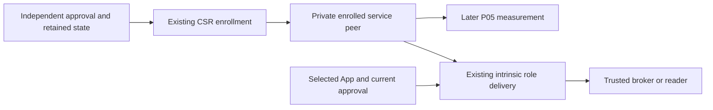

# T013P06 enrollment and issuance subplan

Status: publication review corrections under the same isolated T013P06 commission;
fresh qualification and cleanup pending. Prior recorded qualified source follows.
Runtime/test/matrix source `ff6ccd7e8d07fc99afc346ba5a8a0c3b88b42e80` passes all
seven ordered gates, 3,561 full parent cases plus 11 subtests and 3,139 mandatory
native cases. Independent retained-state and cleanup audits pass; only existing
T013P06 is checked. See [the closeout](evidence.md#t013p06-isolated-qualification-closeout-2026-11-22).
Publication, hosted CI, local Codex review and source ratification remain separate.
Setup/dispatch, P07-P09 and live provider/issuer or human/consumer acceptance remain
ungranted. Earlier preparation checkpoints below retain their historical meaning.

## Accepted source and qualification gates

Brett ratified [openXwallet #101](https://github.com/opensoft/openXwallet/pull/101)
at `dc9ec9eb5e81508ce99134b8c2c4a88c417aae88` for source acceptance. It landed
normally, without an administrative override, as
`841f1bd230ac4452d5663adc50569c072cd4d32f`; both trees are
`829dca6f3cc795edb7a80a81ec6a80fa9b6a1a8f`.

Brett subsequently ratified [openXwallet #102](https://github.com/opensoft/openXwallet/pull/102)
at `26e6a1efe739610a39a756e31582cbf03dff7bf1` and directed landing when green,
fresh main verification, then this preparation refresh. Normal squash merge
`4ca798601566091564a5696fdd89559f8d207885` has the exact ratified tree
`6d98e9698de4ea77ecee7e823f75899032f14b5b`. It changes only the ordinary
pytest job cap from 90 to 120 minutes and its owning governance records;
runtime bounds and protected workflow remain unchanged.

The [fresh main run](https://github.com/opensoft/openXwallet/actions/runs/45055670097)
passes all five jobs: 3,451 full parent tests plus 11 subtests and all 3,029
mandatory native cases, with zero failures, errors or skips and exact identity
sets preserved. The combined job completed in 95m24s. Four source manifests
and all pinned trees match the accepted source; the disjoint 3,450 plus 1
coverage partitions cover the full parent suite. All six unchanged main Sonar
conditions are evaluated and green: coverage 87.4%, duplication 0.1%, hotspot
review 100% and all three ratings at 1. The original August 27 baseline and
18,156 qualifying new lines remain intact. The [receipt](p3-parent-main-qualification.json)
binds this run and analysis to a fresh GitHub/main and latest-Sonar readback.
It documents this historical source run; it is not a runtime evidence profile,
authority input or operational grant.
The historical #101 main attempts both exceeded 90 minutes during native and
skipped Sonar; neither failed attempt is promoted to qualification.

The parent main qualification gate is closed for this recorded source only.
The pre-existing client freshness/ordering limitation is unchanged: this
as-of readback does not establish a permanent workflow guarantee. Later
implementation and publication require their own exact-source qualification.

The source contract is factory R06 in the
[accepted factory delta](https://github.com/opensoft/openXfactory/blob/15d6328ba428/openspec/changes/add-protected-runtime-azure-composition/specs/protected-runtime-azure-composition/spec.md#L67),
with the unchanged budgets and privacy in
[design D9](https://github.com/opensoft/openXfactory/blob/15d6328ba428/openspec/changes/add-protected-runtime-azure-composition/design.md).
The [P3 plan](p3-azure-composition-plan.md) and
[acceptance matrix](p3-azure-composition-acceptance.md) remain authoritative.
This subplan refines existing wiring, not those contracts or public profiles.

Brett subsequently commissioned implementation and testing of this existing row
in isolation. Any failed prerequisite remains open; the commission does not waive it.
P07-P09, T001/T013/T014/T015, operational appointments, codeXfactory 058 T002 and
independent human/domain acceptance remain separate. Feedback is deferred;
historical blocked writes remain unreplayed.

## Outcome and boundaries

Compose existing independently approved certificate enrollment, private App-role
delivery and retained state so an approved service succeeds and a genuine worker
with a valid request is denied. The fixed issuance target remains
`workflow.REPOSITORY`, currently `opensoft/openXwallet`. codeXfactory is the
first-pilot consumer; its name does not replace that target or broaden the App
installation. This is not a general dispatcher or human authenticator.

Runtime ordering starts with independent bootstrap approval, followed by
enrollment and private service credentials. Those peers can later support P05
measurement. Do not require a P05 `VerifiedRemote` to bootstrap the peers that
produce it, and do not convert it into a local `FinalizedPlan` or `ProcessLaunch`.

P06 adds no default listener, configuration flag, environment/plugin activation,
manual input, runtime/source role, public endpoint or evidence field. The
original default entrypoint and `operational_bindings` keep refusing. Source
entrypoint selection and deployment packaging belong to P08.

## Existing ports to compose

| Port | Preserved binding |
| --- | --- |
| `hosted.enrollment.EnrollmentSelection` | Independently approved ref, host/incarnation, source, case/plan, UID/role, public key and bootstrap-peer digests, issuer/key version, CA certificate digest and bounded validity |
| `EnrollmentCurrent` / `EnrollmentAuthority` | Fresh independent principal/selection/ref/nonce approval; actual server-side verified mTLS peer; genuine CSR signature and approved public key; retained reservation before signing |
| `hosted.issuance.AppSelection` / `IssuanceCurrent` | Exact App/client/installation/owner/repository, versioned key URI/public key, enrollment digest and independent current principal/ref/nonce/scope/expiry |
| `InstallationIssuer` / `RoleDelivery` | Intrinsic role, actual fixed-version signature and provider readback, exact returned permissions/repository/expiry, private delivery and non-renewing resolution |
| `hosted.nonces.NonceLedger` | Existing explicitly initialized private POSIX store, selected identity, one-use consumption and refusal on unavailable or inconsistent state |
| `hosted.credential` | Existing selected kernel credential capability and private reply channel; no ambient identity or worker-visible credential |
| `InstallationRetirer` | Existing private credential retirement and independent refusal readback; this is not P07 cloud infrastructure reconciliation |

Do not copy or weaken primitive implementations. P06's implementation scope is
`azure_composition/issuance.py`, its substantive integration tests and measured
matrix metadata. If a primitive or shared contract cannot meet the accepted
requirements, prepare a repair at its owner through the governed process; do not
silently add that repair to this adapter or widen authority.

## Composition strategy

A trusted, explicit source construction site supplies existing selections,
independent current-fact readers, original Decision and transports, credential
capabilities and already-opened retained ledgers. Caller request fields, CSR
subjects, possession of a bootstrap key and returned provider JSON cannot select
their own approver, role, host, source, store or effective authority.

The existing enrollment request keeps exactly its eight keys:
`ref`, `host_ref`, `incarnation_ref`, `source_digest`, `uid`, `role`, `nonce`, `csr`.
Its role is validated against the independent selection. The existing private
role-delivery request keeps exactly `ref` and `nonce`; its role is intrinsic to
the selected enrollment and issuer. No new wire profile or permissive parser is
needed. Existing canonical/body/CSR/certificate limits stay in force.

App roles remain exactly `broker`, `reader` and `source-reader`. Their existing
permissions are exact, not subsets: broker has actions write and metadata read;
reader has actions read and metadata read; source-reader also has contents read.
Certificate-only helper enrollment does not itself authorize an App grant.
Wrong-role and same-role/different-enrollment substitutions must refuse.

Independent facts must corroborate current host/incarnation/source/UID, public
key and actual peer fingerprint, case/plan, selected approval principal and
nonce, effective permissions and expiry. The two P05 observer identities and
approval/credential origins retain their existing independent bindings.
Actual operational administration remains unconfirmed; isolated principals do
not establish live independence. Host-root and platform administrators remain
an explicit common TCB.

Keep the original selected Decision, ledger identities and earliest wall and
monotonic bounds through every nested fact read, credential resolution and
private/provider call. Reuse the existing accounting protections where their
exact types apply; never create a replacement proof Decision, hide multiple
issuer calls behind one uncharged RPC or assume callbacks cannot mutate state.
A complete positive must demonstrate budget fit before broader implementation.
An embedding that cannot preserve these bounds is ineligible until a separate
owner amendment; it cannot borrow a new phase or increase a runtime limit.

Use existing closed GitHub routes and exact versioned Vault signing. Destination
URLs and credentials cannot come from request bodies, arbitrary config or
ambient managed identity. Fixture transport translation must still validate the
original closed operation before routing to an explicitly selected loopback
service. No live Vault, GitHub App, Graph, Entra or Azure request is authorized by
this plan or by a later isolated-only test commission.

## Retained state, failure and private material

Enrollment, App issuance and measurement have distinct selected state purposes.
Pass pre-opened `NonceLedger` instances with their retained identities; do not
accept a worker-selected path or create a fresh store per request. Initialization
belongs to separately authorized setup. Future isolated fixtures may initialize
their own stores before constructing the tested adapter and before untrusted
execution; the runtime module must not initialize them.

Missing, replaced, symlinked, corrupted or wrong-schema state must refuse before
privileged effects. There is no runtime create/repair/delete-and-recreate,
restore, migration or rewind of committed consumption. Preserve the primitive's
existing transaction/savepoint behavior; ordinary failed-business rollback must
not erase an already committed reservation. Retained software state is not
claimed to resist a trusted administrator restoring storage.

Consume the one-use request before signing/provider effects. A lost response
remains consumed and indeterminate, with no automatic mint/enrollment retry,
replacement nonce or fabricated cleanup success. Preserve a private pending
capability when the existing issuer obtained a token before later validation
failed. A returned long-lived token cannot renew authority: `use_until` remains
clipped to the original Decision and current selection.

Keep `Unavailable` distinct from authenticated peer denial. Missing state,
provider outage and transport uncertainty cannot prove worker exclusion.
Known private credentials use existing authorized retirement and independent
readback; unknown-token outcomes remain incomplete. P07's external watchdog,
namespace and cloud-resource retirement are not implemented here.

The workload receives no privileged assigned identity, CA/App/custody key,
bootstrap/helper credential, issuer/admin socket or measurement/state-policy
write capability. Use existing worker confinement and kernel credential reply
capabilities. Do not claim POSIX mode bits alone prove exclusion when actors
share a UID. Actual service TLS keys stay at their selected trusted actor; CSR
enrollment is not private-key distribution. Retained reports contain only
allowed bounded readback/digests, never raw tokens, bearer URLs, private keys,
provider payloads or human-factor/browser material.

## Isolated acceptance controls

These are acceptance criteria for the existing T013P06 row, not another
executable task list and not claims that new tests already exist.

| Control | Required observation |
| --- | --- |
| Complete approved role | Actual CSR signing, mTLS role authentication, kernel credential resolution, fixed-version RSA signature and selected installation/repository/token readback succeed through the new composition under original bounds |
| Genuine worker denial | Establish service availability; use an unused independently approved valid preimage with the real worker TLS peer; deny before reservation/signing/minting; then the same request bytes succeed through the approved service |
| Independent approval | CSR subject, bootstrap-key holder, caller role/ref, candidate source and self-returned approval cannot replace independent current facts |
| Single substitutions | Nonce, host/incarnation, source, case/plan, UID/role, key version/public key, fingerprint, enrollment digest, approval principal, effective permissions/repository and expiry each refuse when mutated alone |
| Peer and confinement | Valid TLS and a known request do not grant the worker service authority; real selected workload confinement denies privileged keys, identity, sockets and policy/state writes |
| State and replay | Missing/corrupt/replaced/aliased store, replay, restart, concurrency and regressed time never initialize or rewind state; one durable winner and consumed uncertainty survive close/reopen |
| Failure and cancellation | Before/after-reservation and post-mint failures preserve state/private cleanup handles; keep exception tracebacks during FD/EOF checks so GC cannot mask a leak; no provider/retirement send replay |
| Budget and freshness | Precharged ledgers, nested callback mutation, expired/changed approval and late material checks cannot refund consumption, renew authority or hide I/O; complete positives actually fit |
| Refusal classification | Provider/readback outage, parser failure, consumed nonce and bad signature are not counted as authenticated worker denial |
| Privacy and cleanup | Canary material stays out of retained readback/errors; independent teardown audit confirms exact owned generations absent, nonce state retained until audit and shared/retained positives preserved |

The worker control cannot use an already consumed nonce to obtain a misleading
refusal. Build a valid unused case, assert no reservation/provider effect during
the worker request, then require approved-service success on the unchanged
bytes. Tests must construct healthy fixtures before applying their one mutation
and fail at the intended assertion rather than an unrelated setup error.

Reuse existing hosted enrollment, issuance, nonce, credential and P05 fixtures
where their assumptions fit. Use real local crypto/TLS/process/state and
independently selected provider/admin doubles. Isolated outcomes do not prove
live provider behavior, assigned identities or actual administration.

## Validation and handoff

The measured parent baseline is 3,451 full cases plus 11 subtests, 3,029 mandatory
native cases and 112 P05 cases. Preserve every prior node identity, fingerprint,
ordering and anchor. Measure the new module's actual collection only after
implementation, then update `matrix_contract.py` with substantive anchors; do not
project a count or relax existing acceptance.

After a later isolated implementation commission, first run substantive P06
positive/refusal controls and the affected existing suites. Freeze the exact
runtime inputs and accepted dependency selections, then require the existing
ordered pin/YAML/normal/strict/full/OpenSpec gates and complete mandatory native
conformance. Retain failed/interrupted attempts as diagnostic. Independently
audit owned process/credential/nonce/file cleanup before disposal. Publication,
exact-head CI, local Codex review under the current owner preference, any needed
approval for a new GLM source-export packet and owner source ratification remain
separate gates. The recorded parent main gate is complete; later source changes
need fresh qualification and may not inherit this receipt as live authority.

The original preparation at `5dc47167444d` changed planning/context documents only.
The subsequent isolated commission now supplies explicit source composition and
regression controls; full/native qualification, independent cleanup and later
publication/review/source acceptance remain distinct. It supplies no live service,
operational App grant, default route or protected origin.

## Recorded isolated result

All 110 P06 controls pass, including actual unused worker preimages followed by
approved-service success on identical bytes for each App role. Each complete
positive preserves the original ten-second bounds and consumes private12,
source4, control2 and key1, including seven actual provider calls, one actual
kernel credential resolution and verified retirement. Existing local independent
fact readers do not hide network I/O; any embedding's I/O readers must use the
same charged clients and Decision. The actor has no default listener or activation.

The independently audited positives retain one issued enrollment and one retired
App token per role. Post-mint returned capabilities remain privately available
for retirement; the deliberate lost mint-response outcome remains consumed and
indeterminate, with no fabricated retirement or automatic retry. Original source,
dependency selections and all earlier matrix identities remain intact. This is
isolated source qualification using provider/admin doubles, not live acceptance.

## P06 publication-review cleanup correction

Local Codex review of PR #103 reproduced P06-R1 and P06-R2 at `3891066d06ac`.
Three real isolated controls fail at the intended assertions without fixture
errors: valid returned mint response lost at the post-return deadline, and known
handle lookup blocked by closed credential channel or missing selected TLS key.
These failures supersede the earlier source's cleanup claim for those scenarios.

The existing owning issuer deliberately stores a token before its post-mint
current-authority check. The composition now returns only the exact selected
GitHub access-token mint response directly to that ordering. All before-send
checks and charges, the issuer's mandatory current checks, and the enclosing
actor guard remain in force; expired/changed authority still refuses delivery.
Other provider operations keep their post-return checks. This adds no new send,
retry, budget, role, destination, primitive or wire behavior.

Private pending lookup now retains original issuer, ledger/path/identity, scope,
role and Decision ownership. It validates the exact IssuedToken against that
selection without reading an issuance-only socket, TLS material, clock or live
storage. This grants cleanup access only; use remains non-renewing and the
existing Retirement checks actual identity/state before provider effects.

The corrected source passes all 127 P06 cases and the three original external
reproductions. Seventeen appended identities cover both delivered/post-mint
failure outcomes across all issuance dependencies, deadline/material loss after
a valid returned response, five capability-ownership substitutions and actual
caller reply-pair cancellation with retained traceback, unchanged FD set and EOF.
All 110 original P06 IDs and every other existing ID/fingerprint/anchor prefix
remain. Collection is 3,578 full parents plus the existing 11 subtests and 3,156
native cases. Complete frozen qualification and independent cleanup are pending.
Initial hosted run45079406606 was intentionally cancelled as superseded, not
promoted to qualification. Hosted CI and local final-delta review require the
corrected exact head. Setup/dispatch unauthorized; feedback deferred; blocked
writes unreplayed. P07-P09 and live human/consumer/provider acceptance stay open.
