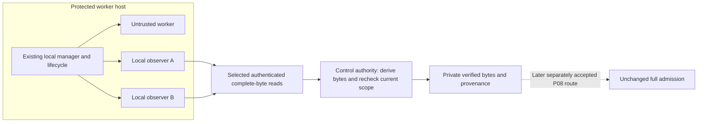

## Current isolated P05 implementation checkpoint - 2026-11-21 UTC

Owner-ratified factory #1359 (`15d6328ba428`) landed first as
`ee1800c7baed409a9679f34c7a87e21dc01ea3d7`; adapter #100 (`d6aa44d9ebef`)
followed as `cc0a91b9991e8b73fa32ddb431d0cfb7bfee20a3`. Both merged trees equal
the ratified trees. Independent main CI and all six unchanged, evaluated Sonar
conditions pass for each merge (factory run44878733896, adapter run44878770163).

The commissioned T013P05 implementation now exists. Its connected isolated
eligibility is demonstrated using protected local current-fact reads, original
manager/process provenance, two independent mTLS observers and complete-byte
recomputation. All 99 focused controls pass together; all 14 deliberately weakened
guard copies are detected without fixture errors. Actual collection adds only
those 99 cases: 3,438 full parents and 3,016 mandatory native cases, preserving
every prior identity, order, fingerprint and anchor prefix. Full/native frozen
qualification and final owned-fixture cleanup remain pending; P05 stays unchecked.
See `p3-measurement-implementation.md` in feature017 for the as-built boundaries.

Earlier dated preparation, unratified, absent-code, unproven-eligibility and
pending-main labels below are historical checkpoints, superseded only for this
bounded P05 source continuation. Provider/admin contents remain isolated doubles;
no operational deployment, issuer, enrollment or actual administrator separation
is demonstrated. P06-P09 and T001/T013/T014/T015, live human and consumer gates,
new P05 publication/review/source acceptance, setup and dispatch remain separate.
Feedback deferred; historical blocked writes unreplayed.

## Current P05 v2 source acceptance and isolated continuation - 2026-11-21 UTC

Brett source-ratified openXfactory #1359 at
`15d6328ba42809dc5cf9280e110b824524b31652` with openXwallet #100 at
`d6aa44d9ebef61e9070b6eff32fe4cc104b4f8c4`, directing ordered landing and
resumption of isolated T013P05. Factory merged first as
`ee1800c7baed409a9679f34c7a87e21dc01ea3d7`; adapter followed as
`cc0a91b9991e8b73fa32ddb431d0cfb7bfee20a3`. Both merge trees equal their
ratified trees. Final PR CI/evaluated gates and nine-role local review passed;
independent post-merge main CI is still being observed separately.

The direct v2 transaction semantics in the paired factory packet are now the
accepted P05 refinement. Earlier draft/unratified/preparation-only labels below
are historical. This grants isolated P05 implementation/testing, not P06-P09,
setup/dispatch, operational selections or live/human/consumer acceptance.
P05 stays unchecked until connected qualification and cleanup actually pass.

Four external accounting diagnostics pass without errors/skips: the existing
network-backed PlanFactReader finalization consumes private12 and six fresh
protection observations; any additional read refuses at private attempt13.
An in-memory private13 counterfactual makes the post-exhaustion refusal control
fail at the intended DID NOT RAISE assertion. That is a route-specific
compatibility finding, not proof that every permitted embedding is ineligible.
Both diagnostic namespaces and 129 generation records were audited; both owned
scratch roots were removed. Product/runtime/test/matrix source is unchanged.

Existing PlanBindings also accepts a trusted local current-fact capability.
The isolated continuation will test actual protected current-journal reads on the
control side, preserving every fact/protection/authority recheck and charging all
remaining RPCs to the original ledger. This is a fixture/source locality choice,
not a selected operational deployment. No cached fact, copied digest, hidden
network read, request/body/budget expansion or clock renewal is allowed. Its
connected manager/independent-observer/complete-byte/budget eligibility remains
unproven; keep the original eligibility stop if it cannot be demonstrated.
Feedback deferred; historical blocked writes unreplayed.

# T013P05 local measurement and remote finalization subplan

Status: isolated T013P05 implementation/testing commissioned on 2026-11-21 UTC;
qualification and later source acceptance remain pending.
Scope: first codeXfactory machine-possession pilot, existing feature017 T013P05.
Branch: `017-p3-measurement-prep`. The sole implementation list is [tasks.md](tasks.md).
This refines that existing row; it creates no additional feature or task list.

## Accepted source and authority

Brett ratified openXwallet #99 at `9e46adca6ee3a4c4487fde93f6809b9f7c7a088c`
for source acceptance only, then directed normal landing when green, independent
main verification and preparation of the next bounded P3 slice. Normal merge
`066cae664f4033ac3b5a508321e1a782b03cf4d4` preserves the ratified tree
`8212c4a3f03e502ce418d5877111df26ec240f27`. Its independent main CI and actual
unchanged Sonar/baseline gate pass; see [the acceptance/main record](evidence.md#pr-99-source-acceptance-and-p05-preparation).
That source identity is a planning basis, not an operational accepted_commit.

The accepted [P3 plan](p3-azure-composition-plan.md), [model](p3-azure-composition-data-model.md),
[internal interfaces](contracts/p3-azure-composition.md) and [acceptance matrix](p3-azure-composition-acceptance.md)
remain the architecture. Factory [R03/R06](https://github.com/opensoft/openXfactory/blob/c2dfbbcc6fa6965fcde18661bddca1dac7128d47/openspec/changes/add-protected-runtime-azure-composition/specs/protected-runtime-azure-composition/spec.md),
[D2/D9](https://github.com/opensoft/openXfactory/blob/c2dfbbcc6fa6965fcde18661bddca1dac7128d47/openspec/changes/add-protected-runtime-azure-composition/design.md) and the [closed remote-measurement boundary](https://github.com/opensoft/openXfactory/blob/c2dfbbcc6fa6965fcde18661bddca1dac7128d47/openspec/changes/add-protected-runtime-azure-composition/supporting-docs/composition-boundary.md)
remain authoritative at that accepted source.

P01-P04 source is accepted. The original instruction at this checkpoint prepared P05 only. P05 code,
P06-P09, T001/T013/T014/T015, consumer058 T002, appointments, actual peer/source
selections, independent human approval, setup and dispatch remain separate gates.
No live token, provider write, credential enrollment, image build or VM operation
is authorized. Feedback deferred; historical blocked writes unreplayed.

## Bounded source seam

Future source belongs in the existing P05 paths, not a neutral-standard fork:

```text
scripts/workload_factory_binding_runtime/azure_composition/local_host.py
scripts/workload_factory_binding_runtime/azure_composition/remote_evidence.py
tests/runtime_binding/test_azure_measurement.py
```

`local_host.py` would compose protected local observation and finalization work
beside the worker kernel. `remote_evidence.py` would authenticate complete remote
observations and independently verify the final bytes on the control side.
Neither is created by this preparation. No default builder, workflow, plugin,
new runtime/source role, dispatch input or predecessor profile changes here.



## Existing APIs and locality

| Accepted source | P05 use and boundary |
| --- | --- |
| [measurement.py](../../scripts/workload_factory_binding_runtime/hosted/measurement.py) | Keep real MeasurementBindings, LaunchObservation and ProcessLaunch. Measure local UID/capabilities, boot, generation, protected roots/files and actual bytes. |
| [host_agent.py](../../scripts/workload_factory_binding_runtime/hosted/host_agent.py), [worker_sandbox.py](../../scripts/workload_factory_binding_runtime/hosted/worker_sandbox.py) | Retain WorkerSpec/HostAgent, actual manager identity, one consumed launch, sandbox and source-selected protected paths. |
| [finalization.py](../../scripts/workload_factory_binding_runtime/hosted/finalization.py) | Preserve local FinalizationBindings/FinalAuthority/finalize and exact type checks. Its independently derived bytes and freshness barriers are requirements, not an existing remote API. |
| [lifecycle.py](../../scripts/workload_factory_binding_runtime/hosted/lifecycle.py) | Keep HostedLifecycle/PosixResources and process/credential/file cleanup on the kernel owning those resources. |
| [private_http.py](../../scripts/workload_factory_binding_runtime/hosted/private_http.py), [readback.py](../../scripts/workload_factory_binding_runtime/hosted/readback.py) | Reuse pinned, bounded selected transport and original read accounting where sufficient. Do not overload ObservationClient's closed operations/profile. |

Retain `reference-posix-session-v1`; replacing it with a systemd/cgroup manager
requires a separate source decision. A remote PID never constructs a local
ProcessLaunch on the control host. The control janitor's PosixResources cannot
become a remote VM reaper. Namespace checks execute at the actual local producer;
no new namespace field is inserted into the factory envelope.

Two observer capabilities are independently selected before the request. Each
must perform actual local reads of the same current generation. Two objects,
ports or response reference strings alone do not establish independence. Preserve
manager ownership and independent observer provenance without constructing a fresh
manager around another process or accepting a worker-selected PID/root/path.
Host-root, platform administrators and approved observer administration remain TCB.

## Complete remote record and peer authentication

The authoritative factory response profile is
`openxfactory-azure-local-measurement-internal-v1`, with exactly these fields:

```text
profile principal_ref independent_observer_refs deployment_ref plan_digest
case_ref source_commit run_id run_attempt launch_ref host_ref incarnation_ref
boot_id invocation_ref pid start_time configuration policy observed_at expires_at
```

Require canonical UTF8 JSON and complete configuration/policy documents. Reject
extra/missing/duplicate keys, invalid types, noncanonical bytes and inconsistent
scope. The entire response, including both documents and all metadata, must fit
16,384 bytes. Existing individual 16,384-byte configuration/policy caps stay.
Two individually fitting documents can still be ineligible when combined.
No truncation, digest-only replacement, split fetch or unmetered paging is allowed.
Larger inherited transport framing caps confer no larger accepted P05 envelope.

Trusted construction selects the expected peers, source/host/incarnation/role,
public fingerprints, protected roots, effective scope/expiry and independent
credential/approval provenance. The response's identity strings are checked
against that selection; they cannot select their own authority or trust roots.
Use current authenticated reads from both observers and compare complete bytes,
generation and case/plan/source/run/attempt/deployment scope. Preserve freshness
through the selected operation and original deadlines, including rechecks after
blocking local file reads and remote I/O.

The accepted response has no nonce, root-map or ledger extension field. Future
implementation must demonstrate request/nonce and credential binding through the
independently selected authenticated operation without extending that closed JSON
or repurposing invocation_ref. A timestamp or matching digest is not proof of a
fresh transaction. If the accepted transport cannot provide the required
correlation, stop for a governed factory/adapter amendment before dependent code;
do not silently overload a predecessor operation or introduce an extra wrapper.
Byte-identical live measurements of an unchanged target are not, by themselves,
a replay diagnosis. Tests must distinguish a live selected read from a copied
snapshot or worker-supplied result.

P06 still owns real enrollment/issuance integration. Isolated P05 fixtures may
supply independently selected peer credentials as fixture capabilities; they do
not establish actual enrollment or appointments. Prove service availability with
a valid request, then explicitly deny the worker's corresponding valid preimage.
Worker exclusion covers helper keys/policy/sockets and privileged identity/broker
access, not merely malformed requests or an unavailable endpoint.

## Independent control-side derivation

Control authority must reconstruct full expected bytes from the independently
approved StaticPlan/templates and trusted worker-host root selection. It must not
resolve worker paths against the controller filesystem or accept a root map from
the response. [ProcessLaunch.measure](../../scripts/workload_factory_binding_runtime/launch.py)
binds the exact artifact digest map and worker projection to PID/start, argv,
cwd and executable digest. Off-host verification therefore needs enough approved
worker-root information to derive those expected process strings independently.

Reuse the accepted pure worker_configuration/canonical/digest helpers and the
`openxfactory-hosted-canonical-finalization-v2` rules. Derive the expected artifact
and process projection, recompute composition, policy composition and the final
configuration's policy digest, and compare both complete canonical documents from
both observers byte for byte. Copying a candidate composition hash into an
otherwise approved template is not independent derivation. Preserve every frozen
template field and permit only the accepted late derivation.

Current source/protection/hold, acknowledged stage/lease and actual-run bindings
must be rechecked after blocking observations and before approval. Unavailable,
revoked, replaced, stale or disagreeing facts refuse. Keep the resulting complete
bytes and remote provenance in a private bound capability for the later accepted
route. Do not fabricate an old FinalAuthority/local-finalize result or claim that
an old report establishes remote origin. Any later reuse of an existing byte
carrier must preserve its fields and retain the separate required provenance.
Actual full admission/grant, proof processing and P08 activation remain separate.

## Original budget and clock ownership

| Existing phase | Unchanged bound |
| --- | --- |
| Ordinary observation | GitHub aggregate 13: correlation 4/source 4/protection 3/control 2; private 12 |
| Protected staging | GitHub aggregate 26: correlation 8/source 8/protection 6/control 4; private 16 |
| Finalization | GitHub aggregate 28: correlation 4/source 4/protection 18/control 2; six protection observations; private 12 and at most two ledger members |
| Qualification | GitHub aggregate 13/private 39; one member, no join or late upgrade |
| Clocks/transport | Original ten-second wall/monotonic remainder, earliest expiry and five-second TLS readiness bound |

Charge every nested remote call to its existing capability slot before use.
The caller retains its original Decision and consumed ledger. Cross-host clocks
are not the same Python object or interchangeable monotonic values; local work
must be bounded by the caller's remaining authority and an independently clipped
local timer. A subordinate timer authorizes no extra proof/read budget.

Keep remote producers limited to selected local kernel/file work. Calling the
public finalize entrypoint per RPC would allocate a new Decision and cannot be
used to refresh the caller's scope. Hidden provider/authority calls require
accounting against the original budget; no fresh child ledger or extra page is
permitted. A complete positive's actual charges and remaining clocks must be
measured before eligibility is claimed. No P05 charge count is guessed here.
P04's effective 512-character bearer/16,377-character POST token bounds and
unqualified real GitHub injection compatibility remain unchanged.

## Acceptance controls for the existing P05 row

This table traces the sole tasks.md row; it is not an additional task list.

| Requirement | Substantive positive | Independent refusal/counterfactual |
| --- | --- | --- |
| R03 locality | Real process/kernel/boot/namespace/files through the selected local manager and both observers | Foreign or changed PID/start/boot/namespace/root/artifact/manager; remote JSON treated as a local capability |
| R03 complete bytes | Fitting complete canonical configuration/policy and independently recomputed approved derivation | One altered byte, both observers agreeing on unapproved policy, digest-only/extra/duplicate/noncanonical/oversized input |
| R03 authentication | Actual pinned peer TLS and separately selected current observer capabilities | Wrong peer/CA/fingerprint/source/host/run/attempt/deployment, collapsed observer identity, copied snapshot or substituted channel |
| R06 worker exclusion | Approved service succeeds; worker submits its corresponding valid canonical request | Worker is explicitly denied despite valid input and known service availability; no credential/policy/identity escalation |
| R11 bounds/privacy | Complete positive records original charges/clocks, fixed errors and private capabilities | Extra read, ledger reset/join/upgrade, expiry/regression, cancellation, credential/state export or private error/context canary |
| R12 scope/cleanup | Existing default refusal and old local positives stay; actual helper/namespace/retention audit | Missing/deselected/skipped prior case, leaked helper, shared-state damage or source result relabeled live/human/consumer acceptance |

Use real local process/TLS/crypto and protected files; provider/admin facts remain
explicit isolated doubles. Start each negative from an available known-good
positive and mutate the intended fact. A failed prerequisite or outage cannot
stand in for the expected refusal. Guard-removal controls must detect the intended
assertion without fixture errors. No private key, request bearer, credential material, full raw
configuration/policy, provider payload or human-factor material enters reports,
logs, repr/state export or retained error cause/context. The authenticated private
response carries the required complete documents; redaction applies to retained
reports/logs, not to removing required bytes from that response.

## Eligibility, qualification and next commission

Before claiming an implementation eligible, demonstrate the local manager seam,
independent root/byte derivation, authenticated request correlation, complete
16KiB positive and actual nested budget fit with accepted interfaces. If any
cannot be demonstrated, record the exact incompatibility and seek the governed
factory/adapter amendment; preserve the old APIs, field sets, limits and refusal.
This preparation neither resolves those experiments nor authorizes them now.

Baseline from accepted main: 3,339 full parent cases plus 11 subtests and 2,917
mandatory native cases. Preserve every prior identity/order, per-module count/
fingerprint and anchor prefix. Measure future P05 cases only after implementation
and append substantive anchors to existing families; requirement R03/R06 names
are not new matrix-family keys. Every source correction needs fresh immutable
full/native qualification, cleanup, hosted CI, local review and owner source act.

Preparation validates relative links, source/task/authority consistency, unchanged
checkboxes and all non-document/pin/workflow bytes, plus the six fast offline
governance gates. Accepted-main CI already qualifies unchanged runtime; do not
repeat hours of full/native tests for this documentation-only preparation.

A later explicit isolated commission can execute the existing T013P05 row using
this subplan. Publication, review/source acceptance, P06 issuance, P07 retirement,
P08 activation, P09 overall qualification, actual roles/services/operational pins,
human approval and consumer gates remain separate. Setup/dispatch unauthorized;
feedback deferred; blocked writes unreplayed.


## Historical initial preparation validation checkpoint

Five local offline checks pass: contract pin, wallet pin, syntax, plain validator
and strict validator. The final local default pinned OpenSpec invocation did not
complete: npm is blocked in the kernel's rtnl_dumpit wait. An attempted dedicated
validation container never left Created; its removal and the blocked npm process
remain pending kernel/runtime recovery. No bench or Docker/WSL restart was made,
and no local OpenSpec success or completed harness cleanup is claimed.

The unchanged governed inputs have independent positive evidence: merged-main
run 44841609525 authenticated the pinned artifact and 80-package closure, then
passed root --all --strict (8 items) and neutral-spec strict validation (7 items).
All 93 tracked OpenSpec/pin/verifier/bootstrap inputs and the other unchanged
baseline files match that verified main. This is the main receipt, not a fresh
local exit or a waiver of any future publication gate. The new P05 document lies
outside the unchanged OpenSpec corpus; its links, scope and checkbox consistency
are checked separately. Complete the blocked local validation/owned-harness
cleanup when runtime recovery can be coordinated safely with active bench work.


## Preparation recovery receipt - 2026-11-21 UTC

The coordinating chat released the Docker maintenance pause after the owning
bench recovered. The unchanged prepared packet at `203a885baf1c39b4b5531aa2e784224ceb2f7b65`
then passed all six offline gates locally: contract pin, wallet pin, syntax,
plain validator, strict validator and the default authenticated shared
`python -B scripts/validate-openspec-cli-pin.py --all` entrypoint. The last
command verified the pinned artifact and 80-package dependency closure and
reported 8 passed, 0 failed strict items. All 407 frozen inputs were rechecked
before and after validation; the worktree remained clean at that prepared head.
No path-mode override, network stub, source substitution or gate waiver was used.

The old blocked process and never-started validation container are absent after
coordinated recovery; no old PID kill was replayed against the new namespace.
The retained old bench scratch and the new six-gate scratch each passed an
independent process/resource audit and exact-root removal. Shared caches,
worktree/source and validation logs remain. This supersedes the environment
blocker above, not any implementation or operational acceptance gate.

This follow-up changes preparation records only. P05 code/tests remain absent,
the P05 checkbox remains unchecked and isolated implementation is uncommissioned.
Publication, source acceptance, P06-P09 and all live operational/human/consumer
gates remain separate. Setup/dispatch unauthorized; feedback deferred; historical
blocked writes unreplayed.


## Isolated P05 implementation commission - 2026-11-21 UTC

After preparation recovery, Brett explicitly answered "Implement and test
T013P05 in isolation" using this plan at `9be62f196694103b6735df9237f511a87b20b10f`.
The existing eligibility conditions and sole task row remain authoritative.
Earlier preparation-only/no-experiment instructions describe their dated scope;
this commission authorizes those isolated feasibility experiments and P05 code,
without changing any accepted contract or completing its checkbox. P06-P09,
setup/dispatch, publication and live human/consumer acceptance remain separate.


## P05 isolated eligibility finding - 2026-11-21 UTC

Four real process/TLS probes establish a fitting complete canonical body and
independent root-based derivation for one fixture, selected-peer availability
and explicit valid-worker denial. They also expose an interface incompatibility
for the required explicit response transaction correlation. The [compatibility
finding and concrete recommendation](p3-measurement-compatibility.md) preserve
the accepted v1/direct-body/operation/budget rules. The original eligibility
stop applies before dependent remote runtime code; direct v2 is proposed only,
not accepted or implemented. Actual local-manager/observer independence and
complete remote finalization budget fit remain unproven. P05 stays unchecked.


## Proposed transaction amendment handoff

The [direct-v2 amendment plan](p3-measurement-transaction-plan.md) follows the
evidenced compatibility finding and the original eligibility guard. Its factory
proposal owns candidate request/response semantics. It is not accepted and does
not replace the v1 source boundary or permit dependent code before exact paired
source acceptance. The existing T013P05 row and all operational gates remain.
